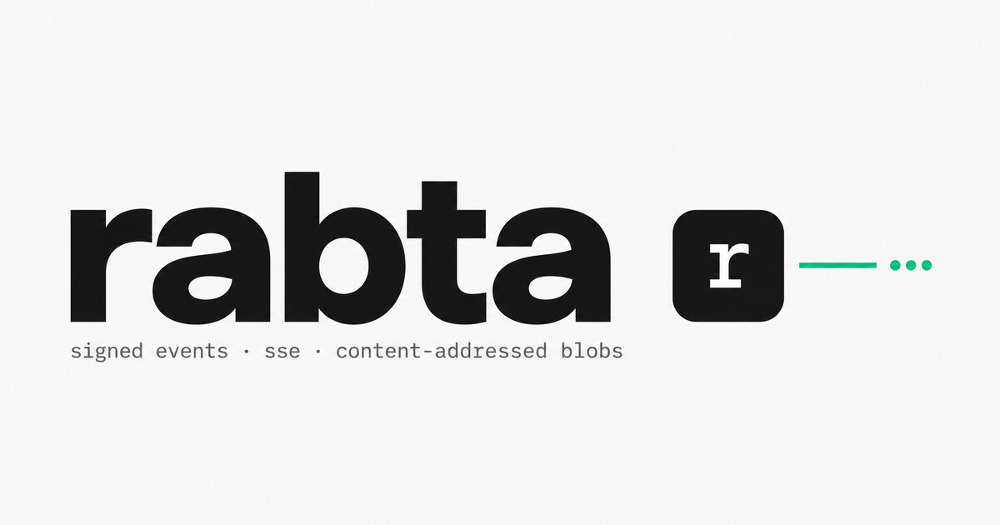

# Awesome Rabta 

  

  
  

**Rabta** is a self-hosted relay for signed events and content-addressed files. It verifies Ed25519 signatures, stores opaque payloads in SQLite, syncs with peer nodes, and expires data automatically — one Rust container, no accounts, no database server, no cloud. Clients own their keys and encryption.

## Contents

- [Nodes](#nodes)
- [Apps](#apps)

## Nodes

| Node                                     | Operator                         | Description                                                     |
| ---------------------------------------- | -------------------------------- | --------------------------------------------------------------- |
| [1.rabta.space](https://1.rabta.space)   | Rabta project                    | Free, public relay with no signup.                              |
| [rabta.t3nk.com](https://rabta.t3nk.com) | [@T3NK](https://github.com/T3NK) | Community node operated by @T3NK. Free, no signup, best-effort. |

## Apps

- [GUPT](https://github.com/besoeasy/gupt) - Anonymous digital life: encrypted chat & calls, passwords, notes, bookmarks, and ephemeral sharing — with no phone number, no email, and no server account.
